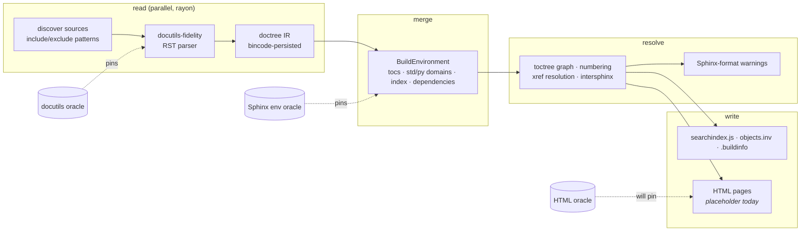

<div align="center">

<picture>
  <source media="(prefers-color-scheme: dark)" srcset="assets/logo-dark.svg">
  
</picture>

# sphinx-ultra

**`sphinx-build`, reimplemented in Rust.**<br>
Parity is verified against real Sphinx 9.1 output, one oracle at a time.

[](https://crates.io/crates/sphinx-ultra)
[](https://crates.io/crates/sphinx-ultra)
[](https://docs.rs/sphinx-ultra)
[](https://github.com/salioglu/sphinx-ultra/actions/workflows/ci.yml)
[](https://codecov.io/gh/salioglu/sphinx-ultra)
[](https://github.com/salioglu/sphinx-ultra/blob/main/Cargo.toml)
[](LICENSE)
[](https://github.com/sponsors/salioglu)

[Install](#install) · [Quick start](#quick-start) · [What works today](#what-works-today) · [How parity is verified](#how-parity-is-verified) · [Roadmap](#roadmap) · [Documentation](#documentation) · [Contributing](#contributing)

</div>

---

> **Pre-1.0. Not yet a replacement for `sphinx-build` in production.**
>
> Everything *behind* the page is real and oracle-verified: a docutils-fidelity
> RST parser, a persisted build environment with the toctree graph, numbering,
> the std and Python domains, intersphinx, and Sphinx's own warnings. Since 0.6.0
> the build also writes `searchindex.js`, `objects.inv` and `.buildinfo` in
> Sphinx 9.1's formats. **The HTML page body itself is still a placeholder**
> (the escaped source text), and there are no themes, `genindex.html`,
> `search.html`, Markdown, extensions or sphinx-needs yet. See
> [What works today](#what-works-today) and
> [docs/IMPLEMENTATION_STATUS.md](docs/IMPLEMENTATION_STATUS.md), which is
> audited file-and-line against the binary.

## Why

Sphinx is the standard for Python and hardware/automotive documentation, and
it is slow on large trees: tens of minutes for tens of thousands of pages, and
a full rebuild whenever `conf.py` moves. sphinx-ultra is a from-scratch Rust
implementation of the same pipeline with one rule: **compatibility is verified,
never claimed.** Every "Sphinx-compatible" statement in this repository is
backed by a differential test against the real `sphinx-build` 9.1.0 or
docutils 0.22.4, run from a pinned environment and committed as a fixture.

The 1.0 target is a drop-in `sphinx-build -b html` with sphinx-needs built in,
the five most used themes, the most used extensions, and parallel, incremental
builds that are 10–100× faster. The plan is in
[docs/ROADMAP.md](docs/ROADMAP.md).

## Install

**From crates.io** (Rust 1.85 or newer):

```bash
cargo install sphinx-ultra --locked
```

**Prebuilt binaries** for Linux (x86_64 glibc and musl, aarch64), macOS
(x86_64, Apple Silicon) and Windows (x86_64) are attached to every
[GitHub release](https://github.com/salioglu/sphinx-ultra/releases/latest),
each with a `.sha256` checksum. On Linux and macOS the install script
downloads the right archive, verifies the checksum and installs to
`~/.local/bin`:

```bash
curl -fsSL https://raw.githubusercontent.com/salioglu/sphinx-ultra/main/scripts/install.sh | sh
```

**From source:**

```bash
git clone https://github.com/salioglu/sphinx-ultra.git
cd sphinx-ultra
cargo build --release          # binary at target/release/sphinx-ultra
```

## Quick start

sphinx-ultra accepts `sphinx-build`'s argument shape, so a quickstart
`Makefile` works by swapping the binary name:

```bash
# Classic sphinx-build style
sphinx-ultra docs _build/html -b html

# Make-mode, what `make html` runs: output goes to _build/html
sphinx-ultra -M html docs _build

# Overrides, nitpicky mode, fresh environment, quiet, all cores, warnings as errors
sphinx-ultra docs _build -D project=MyDocs -n -E -q -j auto -W -w warnings.log
```

Supported: positional `SOURCEDIR OUTPUTDIR`, `-b html`, `-M html`/`-M clean`,
`-c`, `-d`, `-D`, `-A`, `-t`, `-n`, `-q`, `-E`, `-a`, `-T`, `-j N|auto`, `-W`,
`--keep-going`, `-w FILE`, repeatable `-v`. Other builders and make-mode
targets exit 2 with an explicit message. Exit codes follow sphinx-build: 0 on
success, 1 on build errors or `-W` with warnings, 2 on usage and configuration
errors. sphinx-build mode is incremental by default.

The native interface is also available:

```bash
sphinx-ultra build --source docs --output _build --jobs 8 --incremental
sphinx-ultra clean --output _build
sphinx-ultra stats --source docs
```

Configuration is auto-detected in this order: `conf.py` (a declarative subset
is parsed, not executed), `sphinx-ultra.yaml`, `.yml`, `.json`, then defaults.
Details are in [docs/configuration.md](docs/configuration.md); a tour of the
CLI is in [docs/getting-started.md](docs/getting-started.md).

## What works today

Status as of v0.6.0, established by tracing the binary's call graph and
running it. Every row marked *verified* has a committed differential fixture
generated from the pinned upstream toolchain.

| Subsystem | Status | Verified by |
|---|---|---|
| **RST parsing** — docutils block + inline grammar, the docutils body directives, Sphinx's directives and roles (`toctree`, `versionadded`, `code-block`, `only`, `math`, `index`, `glossary`, the `py:*` and std object directives, …) | ✅ Working | 735 docutils + 489 Sphinx read-phase cases, zero divergence; `contents`/`sectnum`/`meta`/`role` and `rst_prolog`/`rst_epilog` are not implemented yet |
| **Build environment** — persisted `BuildEnvironment`, toctree graph and relations, `numfig` numbering, toctree consistency warnings (missing or excluded entries, orphans, multiple parents), Sphinx's outdated-document computation | ✅ Working | 29-project / 84-document environment oracle, zero divergence on every compared key |
| **std domain + cross-references** — labels, glossary terms, `option`/`envvar`/`confval`, `:ref:`/`:numref:`/`:doc:`/`:term:`/`:any:`, nitpicky mode, Sphinx's dangling-reference warnings | ✅ Working | environment oracle |
| **Python domain** — all fourteen `py:*` directives with a real signature grammar (`ast.unparse` port, PEP 695), doc fields, `:py:*:` resolution, `py-modindex` data | ✅ Working | environment oracle, 122 py signature/config cases; the bare `.. function::` spellings that `primary_domain` routes to `py` are not wired yet |
| **`include` / `literalinclude`** — full option sets incl. `:pyobject:`, `:diff:`, `:dedent:`; included files tracked as rebuild dependencies | ⚠️ Partial | environment oracle; a *missing* include file is not reported yet (see below) |
| **intersphinx** — `intersphinx_mapping` validation, local and HTTPS inventories with TLS options and an on-disk cache, `:external:` roles | ✅ Working | 12-file `objects.inv` oracle |
| **`searchindex.js`, `objects.inv`, `.buildinfo`** — Sphinx 9.1 formats: a port of `IndexBuilder` with the Snowball English stemmer, the inventory writer, `stable_hash` config/tag hashes | ✅ Working (0.6.0) | 25k-word stemming fixture; artifacts compared against `sphinx-build` for every HTML fixture |
| **Incremental builds** — blake3 config fingerprint, per-document doctrees, dependency-driven invalidation | ✅ Working | end-to-end CLI suite |
| **Warnings and exit codes** — Sphinx's texts and `[type.subtype]` categories, `-W`, `-w`, `--keep-going` | ✅ Working | environment oracle (full warning stream), CLI suite |
| **Directive and role validation** — 10 + 10 built-in validators on every build | ⚠️ Partial | unknown directives stay silent |
| **General index** — `genindex` data at Sphinx parity | ⚠️ Partial | environment oracle; no `genindex.html` page yet |
| **`conf.py`** — strings, numbers, booleans, nested lists/dicts/tuples, string concatenation; every unsupported construct warns with its line | ⚠️ Partial | CLI suite; dynamic values need the Python sidecar (M5) |
| **HTML pages** | 🔴 Placeholder | each page is `<html><body>` + the escaped source; the 1,406-case HTML oracle is red by design until the writer lands |
| **Themes, templates, `search.html`, `genindex.html`, static assets** | 🔴 Not yet | library code exists (minijinja engine, `HTMLBuilder` mirror), not wired |
| **Markdown / MyST** | 🔴 Not yet | `.md` files get a page but no parsed structure |
| **Extensions, autodoc, sphinx-needs** | 🔴 Not yet | listing an extension has no effect; a constraint engine exists as a library |
| **Other builders (`dirhtml`, `latex`, …), live-reload server** | 🔴 Not yet | roadmap M3 and M7 |

Two gaps are worth knowing before you point `-W` at a real project:

- **docutils-level diagnostics are not printed yet.** Messages docutils
  records *inside* the doctree (unknown directives, a missing or circular
  `include`, title-underline problems) are built faithfully but do not reach
  stderr or the `-w` file, so a broken include path drops its content silently
  and `-W` stays green. This is the first item of the HTML-writer wave.
- **References into the `c`, `cpp`, `js` and `rst` domains are counted, not
  resolved**, until those domains land (M5).

## How parity is verified

Each layer of the pipeline has its own oracle: a Python generator runs the
pinned upstream (`sphinx==9.1.0`, `docutils==0.22.4`, `sphinx-needs==8.5.0`)
from a locked environment, records what it produces, and a Rust test replays
the same input through sphinx-ultra and compares byte-for-byte. The fixtures
are committed; CI needs no Python.

| Oracle | Cases | Compares |
|---|---|---|
| docutils doctree | 735 | pseudo-XML of the parse layer |
| Sphinx read phase | 489 | pseudo-XML after Sphinx's directives and roles |
| Build environment | 29 projects, 84 documents | `tocs`, relations, numbering, std and py registries, index entries, resolved doctrees, the full warning stream |
| Pattern matching | 881 | `sphinx.util.matching` verdicts for `include_patterns` / `exclude_patterns` |
| `objects.inv` | 12 inventories | header bytes and decoded records, both directions |
| English search terms | 25,000 words | Snowball stem and final indexed term |
| **HTML output** | 1,264 core + 142 sphinx-needs projects | the whole output tree, `searchindex.js`, `objects.inv`, `needs.json`, warnings, exit class — *red by design until the HTML writer; run on demand* |

The test suite is 1,125 tests across 14 targets, all green on Linux, macOS and
Windows. Regeneration commands and the exemption tables (every known gap is
pinned so that fixing it fails a test until the entry is removed) are in
[docs/testing.md](docs/testing.md).

## Performance

No end-to-end numbers are published yet. The parallel read phase, the
incremental environment and the search/inventory writers are real, but a
benchmark that stops at a placeholder page would measure the wrong thing.
Corpus-based benchmarks with regression gates arrive with the HTML writer
(roadmap M2 wave 5 and M7).

## Architecture



The crate is one binary plus a library (`sphinx_ultra`) whose modules mirror
the subsystems above: `rst/` and `doctree/` (parser and IR), `env/` (the
environment, toctree, numbering, std and py domains, genindex, objects),
`py/` (signature grammar), `intersphinx/`, `search.rs`, `inventory.rs`,
`builder.rs` (the pipeline) and `config.rs` / `python_config.rs`. API docs
are on [docs.rs](https://docs.rs/sphinx-ultra).

## Roadmap

| Milestone | Theme | Status |
|---|---|---|
| M1 | Honest, solid core: trustworthy CLI, exit codes, cache, patterns | ✅ shipped in 0.4.0 |
| M2 | A real doctree: parser, environment, domains, `include`, search/inventory artifacts | 🟡 waves 1–4.5 shipped (0.4.1–0.6.0); **wave 5, the HTML writer, is next** |
| M3 | Themes and search: alabaster, sphinx-rtd-theme, furo, pydata, book; `search.html` | ⬜ |
| M4 | Extensions wave 1, native: mathjax, copybutton, extlinks, autosectionlabel, todo, graphviz, mermaid, sphinx-design, napoleon, … | ⬜ |
| M5 | Python bridge: dynamic `conf.py`, autodoc, autosummary, myst-parser | ⬜ |
| M6 | sphinx-needs, first-class | ⬜ |
| M7 | Production: benchmarks, i18n, LaTeX/EPUB/man builders, live reload, 1.0 | ⬜ |

The full plan, with the theme and extension support matrices and the testing
strategy, is [docs/ROADMAP.md](docs/ROADMAP.md).

## Documentation

| Document | What it covers |
|---|---|
| [docs/getting-started.md](docs/getting-started.md) | Installation, both CLI modes, a first build, troubleshooting |
| [docs/configuration.md](docs/configuration.md) | `conf.py` subset, the YAML/JSON schema, `-D` overrides, which keys the build consumes |
| [docs/IMPLEMENTATION_STATUS.md](docs/IMPLEMENTATION_STATUS.md) | Audited status of every subsystem with evidence and known divergences |
| [docs/testing.md](docs/testing.md) | The oracles, how to regenerate fixtures, how to run the HTML differential |
| [docs/ROADMAP.md](docs/ROADMAP.md) | Milestones, support matrices, risks |
| [docs/SPHINX_PATTERNS_COMPATIBILITY.md](docs/SPHINX_PATTERNS_COMPATIBILITY.md) | `include_patterns` / `exclude_patterns` semantics |
| [docs/CONTRIBUTING.md](docs/CONTRIBUTING.md) · [docs/RELEASING.md](docs/RELEASING.md) · [docs/SECURITY.md](docs/SECURITY.md) | Development workflow, the release process, the security policy |
| [CHANGELOG.md](CHANGELOG.md) | Release history |

## Contributing

Issues, test reports from real documentation trees, and pull requests are
welcome. The development loop is:

```bash
scripts/dev.sh setup           # toolchain components, cargo-audit, cargo-deny, cargo-llvm-cov
scripts/dev.sh check           # fmt + clippy -D warnings + cargo test --locked
scripts/dev.sh install-hooks   # pre-commit and pre-push hooks
```

Commits follow [Conventional Commits](https://www.conventionalcommits.org/)
(`feat:`, `fix:`, `docs:`, …); release-please turns them into the changelog
and the next version. Read [docs/CONTRIBUTING.md](docs/CONTRIBUTING.md) before
your first pull request, and [docs/SECURITY.md](docs/SECURITY.md) for how to
report a vulnerability privately.

## License

MIT. See [LICENSE](LICENSE).

sphinx-ultra is an independent project. It reimplements the behaviour of
[Sphinx](https://www.sphinx-doc.org/), [docutils](https://docutils.sourceforge.io/)
and [sphinx-needs](https://sphinx-needs.readthedocs.io/), whose test suites and
source are the oracles this project is measured against. Thanks to
[@johnml1135](https://github.com/johnml1135) for the search index, inventory
and `.buildinfo` writers and the HTML oracle corpus.
