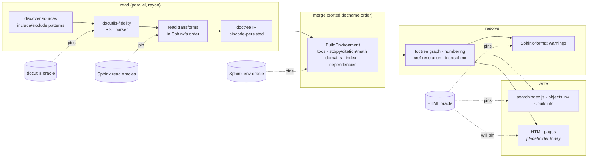

<div align="center">

<picture>
  <source media="(prefers-color-scheme: dark)" srcset="assets/logo-dark.svg">
  
</picture>

# sphinx-ultra

**`sphinx-build`, reimplemented in Rust.**<br>
Parity is verified against real Sphinx 9.1 output, one oracle at a time.

[](https://crates.io/crates/sphinx-ultra)
[](https://crates.io/crates/sphinx-ultra)
[](https://docs.rs/sphinx-ultra)
[](https://github.com/salioglu/sphinx-ultra/actions/workflows/ci.yml)
[](https://codecov.io/gh/salioglu/sphinx-ultra)
[](https://github.com/salioglu/sphinx-ultra/blob/main/Cargo.toml)
[](LICENSE)
[](https://github.com/sponsors/salioglu)

[Install](#install) · [Quick start](#quick-start) · [What works today](#what-works-today) · [How parity is verified](#how-parity-is-verified) · [Roadmap](#roadmap) · [Documentation](#documentation) · [Contributing](#contributing)

</div>

---

> **Pre-1.0. Not yet a replacement for `sphinx-build` in production.**
>
> Everything *behind* the page is real and oracle-verified: a docutils-fidelity
> RST parser, docutils' and Sphinx's read transforms, a persisted build
> environment with the toctree graph, numbering, the std, Python, citation and
> math domains, intersphinx, and Sphinx's own warnings and docutils' diagnostics,
> printed as `sphinx-build` prints them. Since 0.6.0 the build also writes
> `searchindex.js`, `objects.inv` and `.buildinfo` in Sphinx 9.1's formats.
> **The HTML page body itself is still a placeholder**
> (the escaped source text), and there are no themes, `genindex.html`,
> `search.html`, Markdown, extensions or sphinx-needs yet. See
> [What works today](#what-works-today) and
> [docs/IMPLEMENTATION_STATUS.md](docs/IMPLEMENTATION_STATUS.md), which is
> audited file-and-line against the binary.

## Why

Sphinx is the standard for Python and hardware/automotive documentation, and
it is slow on large trees: tens of minutes for tens of thousands of pages, and
a full rebuild whenever `conf.py` moves. sphinx-ultra is a from-scratch Rust
implementation of the same pipeline with one rule: **compatibility is verified,
never claimed.** Every "Sphinx-compatible" statement in this repository is
backed by a differential test against the real `sphinx-build` 9.1.0 or
docutils 0.22.4, run from a pinned environment and committed as a fixture.

The 1.0 target is a drop-in `sphinx-build -b html` with sphinx-needs built in,
the five most used themes, the most used extensions, and parallel, incremental
builds that are 10–100× faster. The plan is in
[docs/ROADMAP.md](docs/ROADMAP.md).

## Install

**From crates.io** (Rust 1.85 or newer):

```bash
cargo install sphinx-ultra --locked
```

**Prebuilt binaries** for Linux (x86_64 glibc and musl, aarch64), macOS
(x86_64, Apple Silicon) and Windows (x86_64) are attached to every
[GitHub release](https://github.com/salioglu/sphinx-ultra/releases/latest),
each with a `.sha256` checksum. On Linux and macOS the install script
downloads the right archive, verifies the checksum and installs to
`~/.local/bin`:

```bash
curl -fsSL https://raw.githubusercontent.com/salioglu/sphinx-ultra/main/scripts/install.sh | sh
```

**From source:**

```bash
git clone https://github.com/salioglu/sphinx-ultra.git
cd sphinx-ultra
cargo build --release          # binary at target/release/sphinx-ultra
```

## Quick start

sphinx-ultra accepts `sphinx-build`'s argument shape, so a quickstart
`Makefile` works by swapping the binary name:

```bash
# Classic sphinx-build style
sphinx-ultra docs _build/html -b html

# Make-mode, what `make html` runs: output goes to _build/html
sphinx-ultra -M html docs _build

# Overrides, nitpicky mode, fresh environment, quiet, all cores, warnings as errors
sphinx-ultra docs _build -D project=MyDocs -n -E -q -j auto -W -w warnings.log
```

Supported: positional `SOURCEDIR OUTPUTDIR`, `-b html`, `-M html`/`-M clean`,
`-c`, `-d`, `-D`, `-A`, `-t`, `-n`, `-q`, `-E`, `-a`, `-T`, `-j N|auto`, `-W`,
`--keep-going`, `-w FILE`, repeatable `-v`. Other builders and make-mode
targets exit 2 with an explicit message. Exit codes follow sphinx-build: 0 on
success (docutils ERROR records included, as in Sphinx), 1 on `-W` with
warnings or a source that cannot be read, 2 on usage and configuration errors.
Warnings go to stderr as `sphinx-build` prints them, and to the `-w` file.
sphinx-build mode is incremental by default.

The native interface is also available:

```bash
sphinx-ultra build --source docs --output _build --jobs 8 --incremental
sphinx-ultra clean --output _build
sphinx-ultra stats --source docs
```

Configuration is auto-detected in this order: `conf.py` (a declarative subset
is parsed, not executed), `sphinx-ultra.yaml`, `.yml`, `.json`, then defaults.
Details are in [docs/configuration.md](docs/configuration.md); a tour of the
CLI is in [docs/getting-started.md](docs/getting-started.md).

## What works today

Status on `main` after M2 wave 5a-1 (unreleased), established by tracing the
binary's call graph and running it. Every row marked *verified* has a committed
differential fixture generated from the pinned upstream toolchain.

| Subsystem | Status | Verified by |
|---|---|---|
| **RST parsing** — docutils block + inline grammar, the docutils body directives, Sphinx's directives and roles (`toctree`, `versionadded`, `code-block`, `only`, `math`, `index`, `glossary`, the `py:*` and std object directives, …) | ✅ Working | 735 docutils + 493 Sphinx read-phase cases, zero divergence; `contents`/`sectnum`/`meta`/`role` and `rst_prolog`/`rst_epilog` are not implemented yet |
| **Read transforms** — docutils' and Sphinx's (targets, substitutions, footnotes and citations, auto-numbering, `docinfo`, glossary sorting, …) in Sphinx's order; the persisted doctree is Sphinx's post-read tree | ✅ Working (wave 5a-1) | the 493 Sphinx cases and the HTML oracle's 734 docutils snippets compared post-read and resolved, zero divergence; a 99-case read-state oracle (ids, registries, warnings), 4 rows open |
| **Build environment** — persisted `BuildEnvironment`, toctree graph and relations, `numfig` numbering, toctree consistency warnings (missing or excluded entries, orphans, multiple parents, circular toctrees), body toctree resolution, Sphinx's outdated-document computation | ✅ Working | 31-project / 89-document environment oracle, every resolved doctree and warning stream byte-for-byte |
| **std, citation and math domains + cross-references** — labels, glossary terms, `option`/`envvar`/`confval`, citations, equations, `:ref:`/`:numref:`/`:doc:`/`:term:`/`:any:`/`:eq:`, nitpicky mode, Sphinx's dangling-reference warnings | ✅ Working | environment oracle |
| **Python domain** — all fourteen `py:*` directives with a real signature grammar (`ast.unparse` port, PEP 695), doc fields, `:py:*:` resolution, `py-modindex` data, the bare `.. function::` spellings `primary_domain` routes to `py` | ✅ Working | environment oracle, 122 py signature/config cases |
| **`include` / `literalinclude`** — full option sets incl. `:pyobject:`, `:diff:`, `:dedent:`; included files tracked as rebuild dependencies; a missing or circular include reported as docutils reports it | ✅ Working | environment oracle |
| **intersphinx** — `intersphinx_mapping` validation, local and HTTPS inventories with TLS options and an on-disk cache, `:external:` roles | ✅ Working | 12-file `objects.inv` oracle |
| **`searchindex.js`, `objects.inv`, `.buildinfo`** — Sphinx 9.1 formats: a port of `IndexBuilder` with the Snowball English stemmer, the inventory writer, `stable_hash` config/tag hashes | ✅ Working (0.6.0) | 25k-word stemming fixture; artifacts compared against `sphinx-build` for every HTML fixture |
| **Incremental builds** — blake3 config fingerprint, per-document doctrees, dependency-driven invalidation | ✅ Working | end-to-end CLI suite |
| **Warnings and exit codes** — Sphinx's texts and `[type.subtype]` categories, docutils' reporter records in Sphinx's record grammar and order, `suppress_warnings`, `show_warning_types`, `-W`, `-w`, `--keep-going` | ✅ Working (records since wave 5a-1) | environment oracle (full warning stream), the warning stream and exit class of all 1,261 runnable core HTML-oracle cases (3 image-scale cases open, owned by the writer), CLI suite |
| **Directive and role validation** — 10 + 10 built-in validators | ⚠️ Native `build` only | off in sphinx-build mode, which prints docutils' and Sphinx's own diagnostics instead |
| **General index** — `genindex` data at Sphinx parity | ⚠️ Partial | environment oracle; no `genindex.html` page yet |
| **`conf.py`** — strings, numbers, booleans, nested lists/dicts/tuples, string concatenation; every unsupported construct warns with its line | ⚠️ Partial | CLI suite; dynamic values need the Python sidecar (M5) |
| **HTML pages** | 🔴 Placeholder | each page is `<html><body>` + the escaped source; the 1,406-case HTML oracle is red by design until the writer lands |
| **Themes, templates, `search.html`, `genindex.html`, static assets** | 🔴 Not yet | M2 wave 5b renders Sphinx's own `basic` and alabaster templates; the unwired M1 engine goes |
| **Markdown / MyST** | 🔴 Not yet | `.md` files get a page but no parsed structure |
| **Extensions, autodoc, sphinx-needs** | 🔴 Not yet | listing an extension has no effect; a constraint engine exists as a library |
| **Other builders (`dirhtml`, `latex`, …), live-reload server** | 🔴 Not yet | roadmap M3 and M7 |

Four gaps are worth knowing before you point `-W` at a real project:

- **`rst_prolog` and `rst_epilog` are not applied yet** (M2 wave 5a-2). A
  reference to a target or substitution defined there prints `Unknown target
  name` or `Undefined substitution referenced`, where Sphinx resolves it.
- **Extensions are not loaded**, so their directives and roles print
  docutils' `Unknown directive type` / `Unknown interpreted text role`
  errors.
- **A warm build re-checks every document**: consistency and cross-reference
  warnings print on every build, where `sphinx-build -b html` prints them only
  for the documents it rewrites, so a warm `-W` build with a dangling
  reference fails where Sphinx's passes (M2 wave 5c).
- **References into the `c`, `cpp`, `js` and `rst` domains are counted, not
  resolved**, until those domains land (M5).

## How parity is verified

Each layer of the pipeline has its own oracle: a Python generator runs the
pinned upstream (`sphinx==9.1.0`, `docutils==0.22.4`, `sphinx-needs==8.5.0`)
from a locked environment, records what it produces, and a Rust test replays
the same input through sphinx-ultra and compares byte-for-byte. The fixtures
are committed; CI needs no Python.

| Oracle | Cases | Compares |
|---|---|---|
| docutils doctree | 735 | pseudo-XML of the parse layer |
| Sphinx read phase | 493 | pseudo-XML of the post-read doctree, after Sphinx's directives, roles and read transforms |
| docutils snippets under Sphinx | 734 | the post-read and the dummy-resolved doctree of the HTML oracle's docutils cases |
| Read state | 99 | the ids `set_id` hands out, the node registries, the final parser position, the warning stream |
| Build environment | 31 projects, 89 documents | `tocs`, relations, numbering, std and py registries, index entries, resolved doctrees, the full warning stream |
| Pattern matching | 881 | `sphinx.util.matching` verdicts for `include_patterns` / `exclude_patterns` |
| `objects.inv` | 12 inventories | header bytes and decoded records, both directions |
| English search terms | 25,000 words | Snowball stem and final indexed term |
| **HTML output** | 1,264 core + 142 sphinx-needs projects | the whole output tree, `searchindex.js`, `objects.inv`, `needs.json`, warnings, exit class — *the pages are red by design until the HTML writer; run on demand*. The warning stream, exit class, `objects.inv` and `searchindex.js` of the 1,261 runnable core cases are gated on every test run |

The test suite is 1,371 tests across 14 targets, all green on Linux, macOS and
Windows. Regeneration commands and the exemption tables (every known gap is
pinned so that fixing it fails a test until the entry is removed) are in
[docs/testing.md](docs/testing.md).

## Performance

No end-to-end numbers are published yet. The parallel read phase, the
incremental environment and the search/inventory writers are real, but a
benchmark that stops at a placeholder page would measure the wrong thing.
Corpus-based benchmarks with regression gates arrive after the HTML writer
(roadmap M2 wave 5c and M7).

## Architecture



The crate is one binary plus a library (`sphinx_ultra`) whose modules mirror
the subsystems above: `rst/` and `doctree/` (parser and IR), `transforms/`
(the read transforms), `diagnostics.rs` (the warning stream), `env/` (the
environment, toctree, numbering, std, py, citation and math domains,
genindex, objects),
`py/` (signature grammar), `intersphinx/`, `search.rs`, `inventory.rs`,
`builder.rs` (the pipeline) and `config.rs` / `python_config.rs`. API docs
are on [docs.rs](https://docs.rs/sphinx-ultra).

## Roadmap

| Milestone | Theme | Status |
|---|---|---|
| M1 | Honest, solid core: trustworthy CLI, exit codes, cache, patterns | ✅ shipped in 0.4.0 |
| M2 | A real doctree: parser, environment, domains, `include`, search/inventory artifacts, the HTML writer | 🟡 waves 1–4.5 shipped (0.4.1–0.6.0); wave 5 in three stages: **5a read-side parity** (5a-1 on `main`), 5b the HTML writer and alabaster, 5c builders and the golden corpus |
| M3 | Themes and search: sphinx-rtd-theme, furo, pydata, book; `search.html` (alabaster moved into M2 wave 5b) | ⬜ |
| M4 | Extensions wave 1, native: mathjax, copybutton, extlinks, autosectionlabel, todo, graphviz, mermaid, sphinx-design, napoleon, … | ⬜ |
| M5 | Python bridge: dynamic `conf.py`, autodoc, autosummary, myst-parser | ⬜ |
| M6 | sphinx-needs, first-class | ⬜ |
| M7 | Production: benchmarks, i18n, LaTeX/EPUB/man builders, live reload, 1.0 | ⬜ |

The full plan, with the theme and extension support matrices and the testing
strategy, is [docs/ROADMAP.md](docs/ROADMAP.md).

## Documentation

| Document | What it covers |
|---|---|
| [docs/getting-started.md](docs/getting-started.md) | Installation, both CLI modes, a first build, troubleshooting |
| [docs/configuration.md](docs/configuration.md) | `conf.py` subset, the YAML/JSON schema, `-D` overrides, which keys the build consumes |
| [docs/IMPLEMENTATION_STATUS.md](docs/IMPLEMENTATION_STATUS.md) | Audited status of every subsystem with evidence and known divergences |
| [docs/testing.md](docs/testing.md) | The oracles, how to regenerate fixtures, how to run the HTML differential |
| [docs/ROADMAP.md](docs/ROADMAP.md) | Milestones, support matrices, risks |
| [docs/SPHINX_PATTERNS_COMPATIBILITY.md](docs/SPHINX_PATTERNS_COMPATIBILITY.md) | `include_patterns` / `exclude_patterns` semantics |
| [docs/CONTRIBUTING.md](docs/CONTRIBUTING.md) · [docs/RELEASING.md](docs/RELEASING.md) · [docs/SECURITY.md](docs/SECURITY.md) | Development workflow, the release process, the security policy |
| [CHANGELOG.md](CHANGELOG.md) | Release history |

## Contributing

Issues, test reports from real documentation trees, and pull requests are
welcome. The development loop is:

```bash
scripts/dev.sh setup           # toolchain components, cargo-audit, cargo-deny, cargo-llvm-cov
scripts/dev.sh check           # fmt + clippy -D warnings + cargo test --locked
scripts/dev.sh install-hooks   # pre-commit and pre-push hooks
```

Commits follow [Conventional Commits](https://www.conventionalcommits.org/)
(`feat:`, `fix:`, `docs:`, …); release-please turns them into the changelog
and the next version. Read [docs/CONTRIBUTING.md](docs/CONTRIBUTING.md) before
your first pull request, and [docs/SECURITY.md](docs/SECURITY.md) for how to
report a vulnerability privately.

## License

MIT. See [LICENSE](LICENSE).

sphinx-ultra is an independent project. It reimplements the behaviour of
[Sphinx](https://www.sphinx-doc.org/), [docutils](https://docutils.sourceforge.io/)
and [sphinx-needs](https://sphinx-needs.readthedocs.io/), whose test suites and
source are the oracles this project is measured against. Thanks to
[@johnml1135](https://github.com/johnml1135) for the search index, inventory
and `.buildinfo` writers and the HTML oracle corpus.
